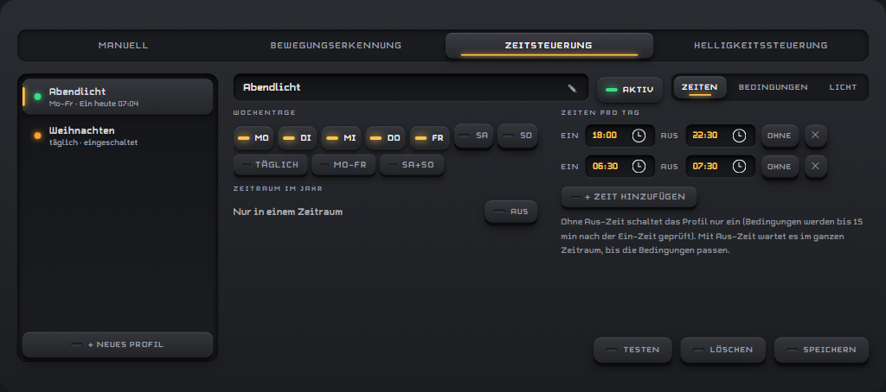

# Light Schedule

Time-based light control for Home Assistant with any number of profiles per room. Each profile turns its lights on at set times (and optionally off again), on selected weekdays and optionally only within a date range, with conditions for presence, alarm state and brightness.


*Schedule tab in the [Room Panel card](https://github.com/SysriX/room_panel_ha_card): profiles with weekdays, on/off times and date range (UI in German)*

Integration domain: `light_schedule`  
Version: 1.4.0  
UI language of the built-in texts (reasons, names): German

> Built for the author's own home. It works with any lights; coordination with motion lighting and some conditions use helper entities from the author's setup (see [Optional helper entities](#optional-helper-entities)). Room ids may need adapting.

## Features

- Up to 30 profiles per room, each with: name, weekdays, optional yearly date range (also across New Year, e.g. 01.12.–31.12.), up to 8 time slots per day (on time, optional off time), lights/groups to switch.
- **Conditions**: presence (always / home / away), alarm (always / disarmed / not away), only when darker than X lx and/or brighter than Y lx (room sensor, outdoor sensor or any sensor).
- **Light settings**: color temperature, color, brightness only, auto or just on; brightness, Kelvin, color, separate on/off transitions. Each lamp gets what it supports.
- **Window logic**: within a slot the profile switches on once as soon as all conditions are met (without off time: up to 15 min after the start). At the off time only lamps this slot turned on and still owns are switched off. A missed off (HA was down) is caught up within 12 hours.
- **Independent profiles** switch regardless of motion/manual/brightness control and do not take ownership.
- **Coordination** with the author's motion lighting (ownership via `input_select.<base>_source` and priority `input_select.<base>_cfg_priority_schedule`) and with [Presence Simulation](https://github.com/SysriX/presence_simulation_ha_integration) (no switching on while it runs with `lock_schedule`). Calls use a child context so the motion lighting does not treat them as manual.
- Every switching action fires the event `light_schedule_switched`.

## Entities

| Entity | Description |
| --- | --- |
| `sensor.<room>_light_schedule` | Number of active profiles in the room; attributes: profiles, running lamps, next switching time |

## Services

| Service | Description |
| --- | --- |
| `light_schedule.set_enabled` | Enable or disable a profile (`profile_id`, `enabled`). IDs are in the `profiles` attribute of `sensor.<room>_light_schedule`. |

A WebSocket API (`light_schedule/save`, `delete`, `test`) is used by the companion card.

## Requirements

- Home Assistant 2024.6 or newer
- Recommended: the companion card for editing profiles (there is no config flow / options UI)

## Installation

### HACS (custom repository)

1. HACS → three-dot menu → **Custom repositories**
2. Repository `https://github.com/SysriX/light_schedule_ha_integration`, category **Integration**
3. Install **Light Schedule** and restart Home Assistant

### Manual

Copy `custom_components/light_schedule` into `<config>/custom_components/` and restart Home Assistant.

## Configuration

YAML only (no config flow). Add to `configuration.yaml` and restart:

```yaml
light_schedule:
  rooms: [wz, bu, ku, sz, fl, ke, ba, bz]   # optional, this is the default
```

`rooms` is a list of short room ids (slugs); one sensor is created per room. The defaults are the author's German room abbreviations – use your own. Profiles are stored in `.storage/light_schedule`.

### Optional helper entities

These come from the author's motion-lighting YAML package (not published). The value of each `input_text` is an entity id. If a helper is missing, the corresponding condition is skipped.

| Helper | Purpose |
| --- | --- |
| `input_text.haus_light_motion_cfg_presence_sensor` | Presence source for the presence condition |
| `input_text.haus_light_motion_cfg_alarm_panel` | Alarm panel for the alarm condition |
| `input_text.haus_light_motion_cfg_lux_sensor` | Outdoor brightness sensor |
| `input_text.<room>_light_motion_cfg_lux_sensor` | Room brightness sensor |
| `group.<room>_light_motion_<primary\|secondary>`, `input_select.<…>_source`, `input_select.<…>_cfg_priority_schedule` | Coordination with motion lighting |

## Companion card

[room_panel_ha_card](https://github.com/SysriX/room_panel_ha_card) (`custom:raum-panel`) – settings → light control → schedule.

## License

MIT – see [LICENSE](LICENSE).
